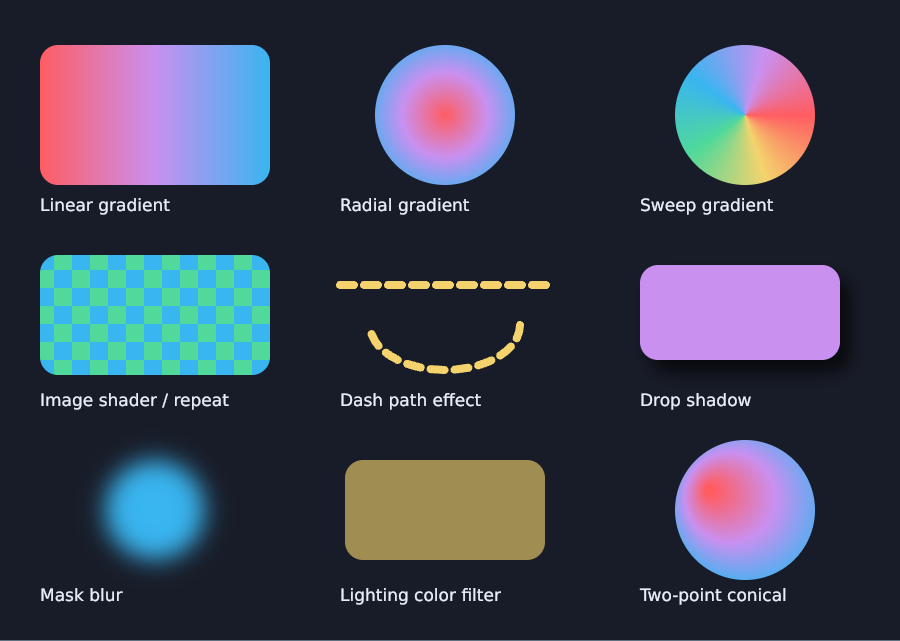
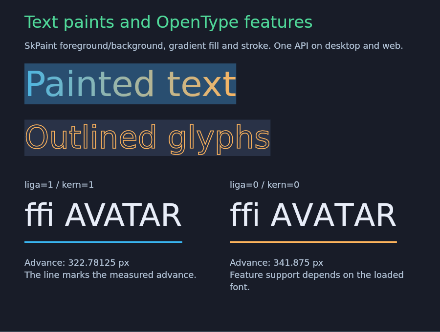

# dasSkia

daScript bindings to [Skia](https://skia.org/) for 2D graphics, images and Unicode
text. The same script API runs on Windows desktop and in the browser through
WebAssembly, including strict AOT.

Use CPU raster surfaces, Skia's Ganesh OpenGL / WebGL 2 backend, or upload raster
output to an existing dasSDL3 `SDL_Renderer`. An application can also attach Skia
to its own dasSDL3 OpenGL window while retaining its event loop and presentation.

| Gradients, shaders and filters | Text paints and OpenType features |
| --- | --- |
| [](examples/effects.das) | [](examples/text_style.das) |

Screenshots show the shared [effects](examples/effects.das) and
[text style](examples/text_style.das) examples running in Chromium with strict
WebAssembly AOT.

## What is included

- Paths, shapes, clipping, matrices, layers, image sampling and copied ARGB pixels.
- Gradients, image shaders, color/image filters, path effects and SkSL runtime effects.
- Path boolean operations, contour measurement, recorded pictures and SKP serialization.
- PNG, JPEG and WebP decoding/encoding, including encoded byte arrays.
- FreeType/HarfBuzz/ICU text shaping and SkParagraph rich layout: bidi text,
  selection geometry, placeholders, strut, variable fonts and OpenType features.
- SDL3 windows, existing dasSDL3 window/renderer integration, resize and WebGL
  context restoration.

This is a focused binding rather than complete Skia coverage. Windows x64 and
Chromium/Firefox WebAssembly are the tested targets. WebGPU/Graphite, SDL_GPU
interop, full SVG documents, PDF and an interactive text editor are outside the
current API. See [testing and platform limits](VALIDATION.md).

## Idiomatic daScript API

The helpers use receiver-first pipes, named options, standard `Result` values and
scoped resources. `skia_use` acquires a resource in `skia_scope`; `skia_try`
propagates an error while leaving scoped cleanup in place.

### Draw to a PNG

This is a complete runnable script. Run it from the repository root so imports
and assets resolve as in the bundled examples.

```das
options gen2
require dasskia/skia_boost
require dasskia/skia_scope

[export]
def main() : int {
    let result = skia_scope() {
        let surface : SkSurface? = with_raster_surface(
            RasterSurfaceOptions(size=int2(800,600))) |> skia_use
        let paint : SkPaint? = with_paint(
            PaintOptions(color=0xff36b5f0u)) |> skia_use
        let c = canvas(surface)
        c |> clear(0xff181c28u)
        c |> draw_rect(float4(60.0,60.0,300.0,160.0),paint)
        c |> draw_circle(float2(480.0,330.0),120.0,paint)
        surface |> save_png("dasSkia.png") |> skia_try
        return skia_ok()
    }
    if (is_err(result)) {
        let e = unwrap_err(result)
        print("{e.operation}: {e.message}\n")
        return 1
    }
    return 0
}
```

Rectangles are `(x,y,width,height)` and packed colors are ARGB. Canvas pointers
are borrowed from their surfaces. Resources borrowed by a `with_*` scope must
stay inside that scope. See [ownership and errors](docs/ownership.md).

### Shape multilingual text

Call this helper with a live canvas and paint. It loads an explicit font and
shapes the string with the same API on desktop and web.

```das
options gen2
require dasskia/skia_text
require dasskia/skia_scope

def draw_label(c : SkCanvas?; paint : SkPaint?) : SkiaStatus {
    return skia_scope() {
        let font : SkFont? = with_font_file(
            "assets/fonts/DejaVuSans.ttf",FontOptions(size=32.0)) |> skia_use
        let text : SkiaText? = font |> with_shaped_text(
            "office • Привет • السلام عليكم",
            TextOptions(width=700.0,language="und")) |> skia_use
        c |> draw_text(text,float2(40.0,40.0),paint)
        return skia_ok()
    }
}
```

For per-frame drawing, shape once during initialization and reuse the result;
[examples/text.das](examples/text.das) shows the complete lifecycle. Rich text uses
[SkParagraph](docs/paragraph-api.md). Fonts are file-backed on both platforms;
web builds preload the bundled assets instead of relying on system fonts.

## Build and run

Dependencies are pinned in [dependencies.json](dependencies.json). The supplied
profile uses Skia m138, SDL 3.4.16, FreeType, HarfBuzz and ICU. The web build uses
Emscripten 5.0.3, wasm32 SIMD and native Wasm exceptions in a single WASM instance.

### Windows desktop

Use Python, Git, CMake and Ninja in an x64 Visual Studio 2022 developer shell:

```powershell
git clone https://github.com/spiiin/DasSkia.git
cd DasSkia
python tools/bootstrap.py
python tools/build_skia.py
cmake -S . -B build/desktop -G Ninja -DCMAKE_BUILD_TYPE=Release -DDASSKIA_AOT_TESTS=ON
cmake --build build/desktop --parallel 6
ctest --test-dir build/desktop --output-on-failure
.\build\desktop\bin\dasSkia_runner.exe examples/raster.das
.\build\desktop\bin\dasSkia_runner.exe examples/effects.das
.\build\desktop\bin\dasSkia_runner.exe examples/text_style.das
```

`raster.das` writes `dasSkia.png`. Window examples run until Escape or window close.
Pass a script filename to the runner. Build all targets before running CTest.
For a raster-only build, set `-DDASSKIA_WITH_SDL=OFF`.

### Browser

After bootstrap, activate Emscripten 5.0.3 and build the web target:

```powershell
python tools/build_skia.py --web --emsdk $env:EMSDK
emcmake cmake -S . -B build/web -G Ninja -DCMAKE_BUILD_TYPE=Release -DCMAKE_EXE_LINKER_FLAGS=-O1
cmake --build build/web --target dasSkia_runner --parallel 6
python -m http.server 8080 --bind 127.0.0.1 --directory build/web/site
```

Open [the example gallery](http://localhost:8080), or go directly to
[Text paints and OpenType](http://localhost:8080/?script=/examples/text_style.das).
Keep the generated JS, WASM and data files together.

For strict AOT, configure `-DDASSKIA_WEB_AOT=ON`, build
`dasSkia_web_aot_runner` and serve `build/web/aot-site`. AOT generation uses
Node 22.3.0; missing AOT artifacts are errors with no interpreter fallback.
See [strict Web AOT](docs/web-aot.md) for the full setup and deployment contract.

[Build instructions](docs/clean-build.md) cover fresh checkouts and the optional
dasSDL3 module. [GitHub Actions](.github/workflows/ci.yml) builds desktop and web
from fresh sources, tests interpreter and strict AOT, and uploads diagnostics.
See [CI and local verification](docs/ci.md).

## Documentation and examples

| Topic | API reference | Runnable examples |
| --- | --- | --- |
| Drawing and images | [Drawing](docs/drawing-api.md), [codecs](docs/image-codecs-api.md) | [drawing](examples/drawing.das), [codecs](examples/codecs.das) |
| Effects and paths | [Effects](docs/effects-api.md), [geometry](docs/geometry-api.md) | [effects](examples/effects.das), [geometry](examples/geometry.das) |
| Recording and SkSL | [Pictures](docs/picture-api.md), [runtime effects](docs/runtime-api.md) | [picture](examples/picture.das), [runtime](examples/runtime.das) |
| Image processing | [Filter graphs](docs/filter-graph-api.md), [advanced filters](docs/advanced-filters-api.md) | [filter graph](examples/filter_graph.das), [advanced filters](examples/advanced_filters.das) |
| Text and layout | [Shaping](docs/text-api.md), [paragraphs](docs/paragraph-api.md), [typography](docs/typography-api.md) | [text](examples/text.das), [paragraph](examples/paragraph.das), [typography](examples/typography.das) |
| Text geometry and styles | [Selection](docs/selection-api.md), [caret](docs/caret-api.md), [inline layout](docs/inline-layout-api.md), [text paints](docs/text-style-api.md) | [selection](examples/selection.das), [caret](examples/caret.das), [inline layout](examples/inline_layout.das), [text style](examples/text_style.das) |
| Windows and SDL | [Lifecycle](docs/window-lifecycle.md), [existing GL window](docs/sdl3-interop-api.md), [SDL_Renderer texture](docs/sdl-texture-api.md) | [window](examples/window.das), [SDL interop](examples/sdl_interop.das), [SDL texture](examples/sdl_texture.das) |

The raw `require skia` module exposes C++ `Skia_*` adapters, not a stable C ABI.
The `dasskia/*` modules add daScript options, results and scopes over those adapters.

## License

[MIT](LICENSE). Skia, SDL, daScript, codecs and bundled fonts retain their own
licenses; see [third-party notices](THIRD_PARTY_NOTICES.md). Scope/Result helpers
were adapted from [dasSDL3](https://github.com/spiiin/dasSDL3).
